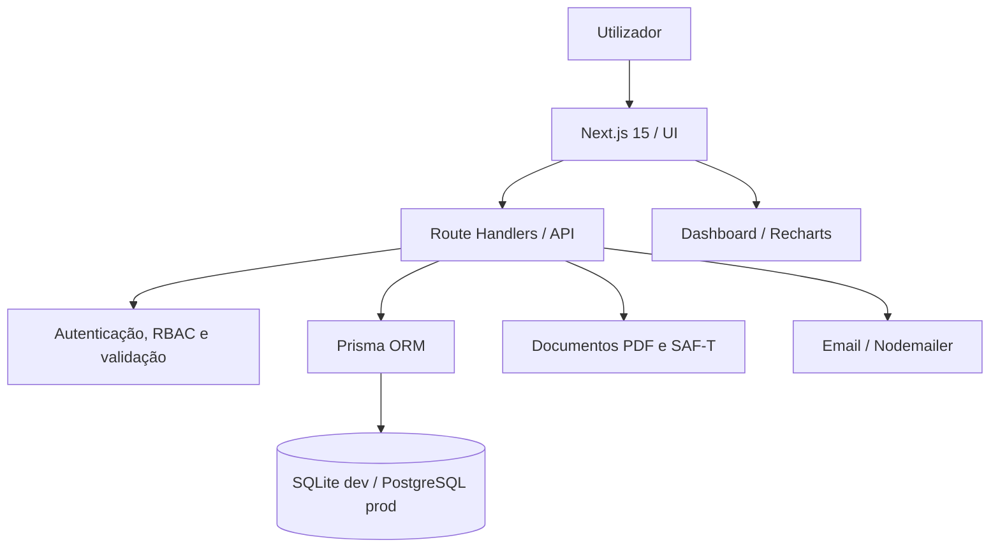

# FaturaAT — Projeto de Sistema de Faturação (Portugal)

Projeto de desenvolvimento de um sistema de faturação e gestão comercial para o mercado português. **Não está declarado como software certificado pela Autoridade Tributária (AT)** e não deve ser utilizado para emitir documentos fiscais reais sem validação técnica, jurídica e certificação aplicável.

## 🚀 Funcionalidades Implementadas

### ⚖️ Requisitos fiscais — implementação por validar
- **Hash de documentos**: implementação de hash encadeado; a conformidade com os requisitos legais deve ser verificada por auditoria independente.
- **ATCUD & QR Code**: funcionalidades de geração em desenvolvimento/por validar face às especificações oficiais em vigor.
- **SAF-T PT**: exportação prevista/implementada no projeto, sujeita a testes de conformidade com o esquema oficial aplicável.
- **Validação AT**: integração e conformidade com os serviços da AT não devem ser consideradas concluídas sem testes oficiais e certificação.

### 💼 Gestão Comercial
- **POS (Ponto de Venda)**: Interface de venda rápida otimizada para retalho com suporte PWA.
- **Portal do Cliente**: Área segura para consulta de documentos e pagamentos online (Mock Stripe/MBWay).
- **Stocks & Inventário**: Suporte a múltiplos armazéns, movimentos automáticos e alertas de stock baixo.
- **Compras & Fornecedores**: Ciclo completo de compras, registo de faturas de fornecedor e pagamentos.
- **Vendas & Orçamentos**: Emissão de Faturas, Faturas-Recibo e Notas de Crédito. Conversão de orçamentos e encomendas.
- **Avenças (Faturação Recorrente)**: Gestão de subscrições com processamento automático em lote.
- **Contas Correntes**: Controlo de saldos pendentes de clientes e fornecedores.
- **Reconciliação Bancária**: Importação de extratos e matching automático com faturas pendentes.

### 📊 Inteligência de Negócio & Conectividade
- **API Pública (v1)**: Integração via API Key para Clientes e Artigos.
- **Webhooks**: Notificações em tempo real para emissão e pagamento de documentos.
- **E-commerce Receiver**: Endpoint para recepção de pedidos e criação automática de rascunhos.
- **Dashboard Avançado**: Gráficos de evolução de vendas, top de clientes e top de artigos (Recharts).
- **Relatórios Profissionais**: Exportação de dados de vendas para Excel (XLSX) e CSV com resumo de IVA.
- **Automação de Email**: Envio de faturas PDF diretamente para o cliente com links seguros.

## 🏗️ Arquitetura de alto nível



O fluxo é conceptual e resume os componentes documentados; não representa uma certificação fiscal nem validação de conformidade com a AT.

## 📸 Demonstração visual

Não foram encontradas capturas de ecrã versionadas no repositório durante esta auditoria. A galeria será acrescentada após captura da aplicação em execução, com dados fictícios e sem documentos fiscais ou dados pessoais reais.

Capturas prioritárias: dashboard, POS, detalhe de documento, inventário e relatórios.

## 🛠️ Stack Tecnológica

- **Framework**: Next.js 15 (App Router)
- **Base de Dados**: Prisma ORM (SQLite em dev, PostgreSQL em prod)
- **UI/UX**: Tailwind CSS 4, shadcn/ui, Lucide Icons
- **Gráficos**: Recharts
- **Relatórios**: ExcelJS
- **Segurança**: JWT (jose), bcryptjs, Rate Limiting, CSRF Protection, Zod Validation, RBAC.
- **Email**: Nodemailer

## 🚀 Início Rápido

1. **Instalar dependências**:
   ```bash
   npm install
   ```

2. **Configurar Base de Dados**:
   ```bash
   npx prisma db push
   ```

3. **Iniciar Desenvolvimento**:
   ```bash
   npm run dev
   ```

## 🔒 Produção (PostgreSQL)

Para ambiente de produção, é obrigatória a utilização de PostgreSQL. Consulte o ficheiro [POSTGRES_MIGRATION.md](./POSTGRES_MIGRATION.md) para instruções detalhadas de migração.

## 📁 Estrutura do Projeto

- `src/app/api`: Endpoints REST protegidos.
- `src/components`: Componentes UI reutilizáveis.
- `src/lib`: Lógica de negócio (fiscal, hash, pdf, email).
- `prisma/`: Esquema da base de dados.

---

## ⚠️ Estado e utilização

Este repositório é um projeto de software em desenvolvimento. A presença de funcionalidades relacionadas com ATCUD, QR Code, hash ou SAF-T não comprova certificação nem conformidade fiscal. Antes de qualquer utilização comercial ou emissão de documentos reais, são necessários testes abrangentes, validação jurídica e técnica e cumprimento do processo de certificação exigido pela AT.

Não introduzas dados pessoais ou fiscais reais em ambientes de teste. Usa dados fictícios e mantém credenciais e segredos fora do repositório.
